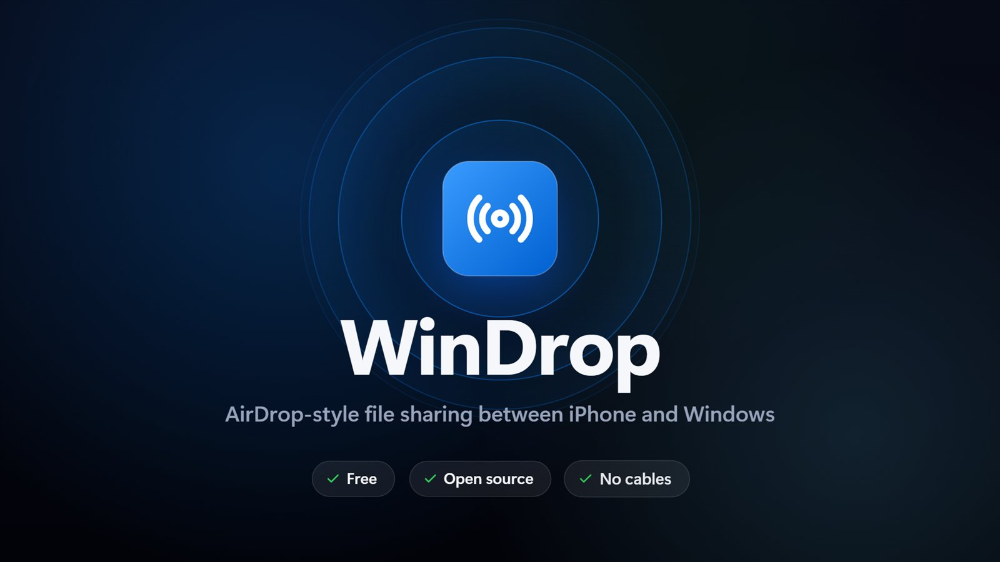
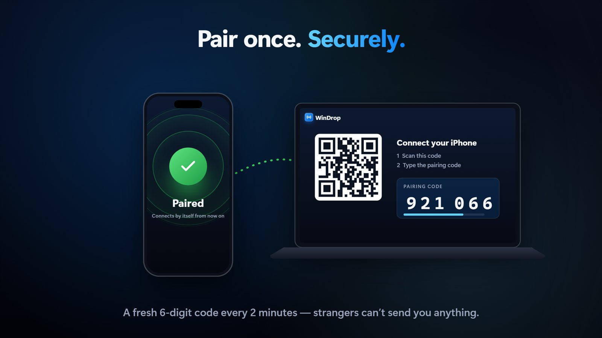
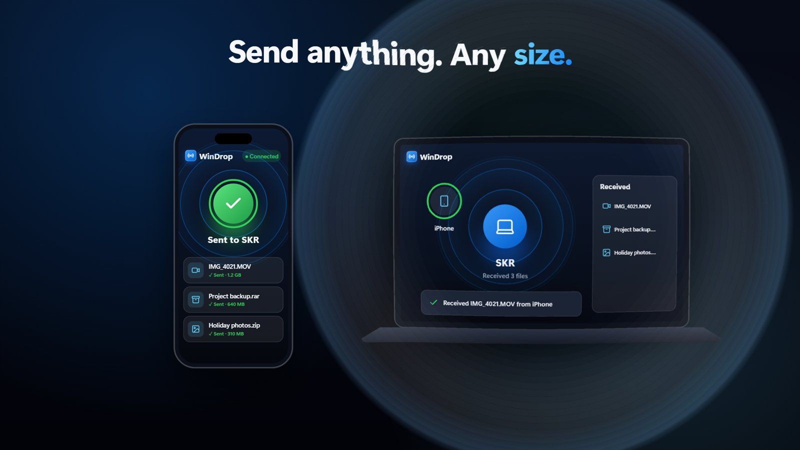
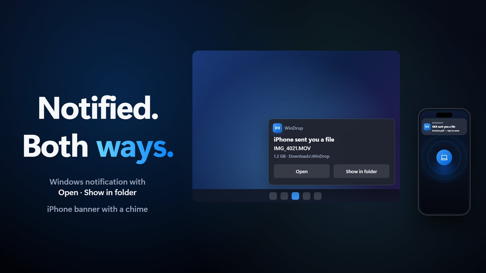
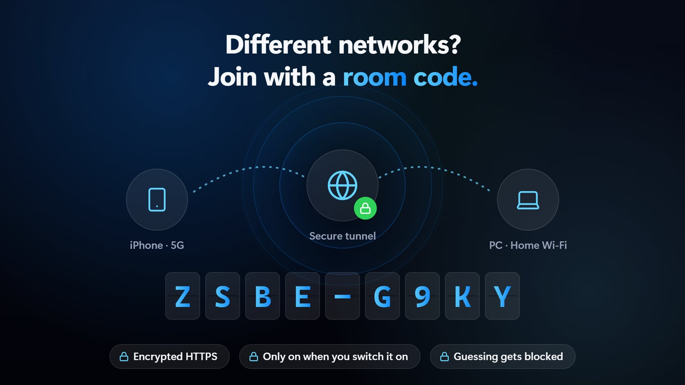
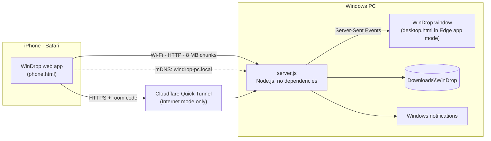

<div align="center">


# WinDrop

**AirDrop-style file sharing between your iPhone and Windows PC.**
Tap, send, done — photos, videos, ZIP, RAR, anything, any size. No cables, no cloud, no app to install on the phone.

[](#requirements)
[](https://nodejs.org)
[](#use-it)
[](package.json)
[](LICENSE)

<a href="docs/windrop-explainer.mp4"></a>

▶ **[Watch the 1-minute explainer](docs/windrop-explainer.mp4)**

</div>

---

## Contents

- [Features](#features)
- [Install](#install)
- [Use it](#use-it)
- [Internet mode (room code)](#internet-mode-room-code)
- [Notifications](#notifications)
- [Security](#security)
- [How it works](#how-it-works)
- [Troubleshooting](#troubleshooting)
- [FAQ](#faq)
- [Uninstall](#uninstall)
- [Project structure](#project-structure)
- [License](#license)

## Features

| | |
|---|---|
| 📲 **iPhone → PC** | Send photos, videos, ZIP, RAR, PDFs — any file type, any size — straight from Safari. Nothing to install on the phone. |
| 💻 **PC → iPhone** | Drag files onto the WinDrop window; they appear on your phone with a **Save** button. |
| 🧩 **Big files, resumable** | Files go in 8 MB pieces. If Wi-Fi drops or the phone locks, sending continues where it stopped. The screen stays awake while sending. |
| 🔐 **Pairing code** | New devices must type a temporary 6-digit code shown on the PC. Strangers on the same Wi-Fi can't send you anything. |
| 🌍 **Internet mode** | Phone on mobile data or another Wi-Fi? Switch on Internet mode and join with a room code over an encrypted tunnel. |
| 🔔 **Notifications both ways** | Windows notification (with *Open* / *Show in folder*) on the PC; an iOS-style banner with a chime on the phone, plus optional real iPhone notifications. |
| ⚡ **Always ready** | Starts with Windows, runs quietly in the background, and your phone finds the PC by name (`windrop-<pc>.local`) even if its IP changes. |
| 🌊 **Ripple effect** | The whole window ripples when a file lands — a port of Apple's SwiftUI *Ripple* shader to the web. |
| 🎨 **Native look** | Fluent design on Windows, iOS glass style on the phone, light & dark mode, Reduce Motion support. |

<table>
<tr>
<td></td>
<td></td>
</tr>
<tr>
<td></td>
<td></td>
</tr>
</table>

## Install

### Requirements

- Windows 10 or 11
- [Node.js](https://nodejs.org) 18 or newer — the installer offers to install it for you
- An iPhone or iPad (iOS 15+) with Safari — Android phones work too, in Chrome

### One line (recommended)

Open **PowerShell** and run:

```powershell
irm https://raw.githubusercontent.com/sumitkumarraju/WinDrop/main/install.ps1 | iex
```

The installer:

1. checks for Node.js 18+ (and offers to install it with `winget`),
2. installs WinDrop to `%LOCALAPPDATA%\WinDrop`,
3. downloads [`cloudflared`](https://github.com/cloudflare/cloudflared) for Internet mode and verifies Cloudflare's signature,
4. makes WinDrop start with Windows and adds Desktop + Start menu shortcuts,
5. opens the WinDrop window.

> **Windows Firewall:** the first time, Windows asks whether Node.js may use the network. Tick **Private networks** and click **Allow** — otherwise your phone can't connect.

### From a download

1. Download the [latest ZIP](https://github.com/sumitkumarraju/WinDrop/archive/refs/heads/main.zip) (or `git clone https://github.com/sumitkumarraju/WinDrop`) and unzip it.
2. Double-click **`Install-WinDrop.bat`**.

### Installer options

Set these before running the installer:

| Variable | Effect |
|---|---|
| `$env:WINDROP_DIR = 'D:\Apps\WinDrop'` | Install to a different folder |
| `$env:WINDROP_NO_TUNNEL = '1'` | Skip the `cloudflared` download (no Internet mode) |

### Run without installing

```powershell
node server.js
```

Runs in the console and opens the window; close the console to stop. `WinDrop.bat` does the same.

## Use it

### 1. Pair your iPhone (once)

1. Open **WinDrop** on the PC (Start menu or Desktop).
2. Scan the QR code with the iPhone **Camera** app.
3. Type the **6-digit pairing code** shown on the PC. It changes every 2 minutes.
4. In Safari tap **Share → Add to Home Screen**. From now on, tap that icon and it connects by itself.

### 2. Send from iPhone to PC

Tap the PC icon (or **Send files**) and pick photos, videos or files.
Tip: choose **Choose Files** in the menu to send original-quality photos instead of the converted versions iOS picks by default.

Files land in **`Downloads\WinDrop`**. Click one in the *Received* list to show it in File Explorer.

### 3. Send from PC to iPhone

Drag files onto the WinDrop window (or click **Send to phone**). They appear under **From your PC** on the phone — tap **Save**.

### Settings in the WinDrop window

| Setting | What it does |
|---|---|
| **Pairing code** · *New code* | The temporary code new devices must type. Each code works once. |
| **Trusted devices** | Every paired device, when it was last active, and ✕ to remove it. |
| **Network** | If the PC has several networks (Wi-Fi + Ethernet), pick the one your phone is on. |
| **Internet mode** | Lets a phone on a different network join with a room code. |
| **Notifications** | Test the Windows notification; set up iPhone notifications. |
| **Start with Windows** | Run WinDrop quietly in the background at every login. |
| ⏻ | Quit WinDrop. |

## Internet mode (room code)

For when the phone and PC are on **different networks** — mobile data, office Wi-Fi, a friend's house.

1. In WinDrop, switch on **Internet mode**. After a few seconds it shows **Online**, a **room code** (like `ZSBE-G9KY`) and a QR code.
2. On the phone, scan the QR code (joins instantly) — or open the link and type the room code.
3. Send files exactly as on Wi-Fi.

- Uses a free [Cloudflare Quick Tunnel](https://developers.cloudflare.com/cloudflare-one/connections/connect-networks/do-more-with-tunnels/trycloudflare/): encrypted HTTPS, no account, nothing stored. It only runs while the switch is on.
- The public link changes each time Internet mode starts; the room code stays until you press **New code** (which also disconnects phones using the old one).
- Over the internet the phone checks for new files from the PC every 3 seconds (on Wi-Fi it's instant).

No Wi-Fi at all? Turn on **iPhone Personal Hotspot** and connect the PC to it — WinDrop works normally and the transfer stays local.

## Notifications

| Where | When | How |
|---|---|---|
| **PC** | A file arrives and the WinDrop window isn't in front | Windows notification with a photo preview and **Open** / **Show in folder** |
| **iPhone (app open)** | The PC sends you files, or the PC received yours | iOS-style banner with a chime |
| **iPhone (app closed)** | The PC sends you files | Optional, via the free [ntfy](https://apps.apple.com/app/ntfy/id1625396347) app |

To get iPhone notifications when WinDrop is closed: in the WinDrop window turn on **Notifications → On my iPhone**, install **ntfy** from the App Store, subscribe to the topic shown, and press **Send test**. Only file names and sizes pass through ntfy.sh — never your files.

> Why ntfy? iPhone Safari only allows real notifications for `https://` sites, and WinDrop runs on plain `http://` inside your own network.

## Security

- **Pairing code.** A device must type the temporary 6-digit code shown on the PC. Codes expire after 2 minutes, work once, and change after 3 wrong tries; repeated guessing is blocked for a few minutes.
- **Per-device keys.** Each paired device gets its own random key, stored only on that device and in `windrop.config.json` on the PC. Remove a device under **Trusted devices** and it's locked out instantly.
- **The QR code holds no secret** — only the address.
- **PC-only controls.** Settings, sharing, quitting and the WinDrop window itself only respond to this PC (`localhost`), never to the network or the internet.
- **Internet mode** is off by default, needs the room code, and runs through Cloudflare's encrypted tunnel only while switched on.
- **Your files never leave your network** on Wi-Fi. In Internet mode they pass through Cloudflare's tunnel (encrypted, not stored).
- File names from phones are sanitized; files are written only inside `Downloads\WinDrop`.

## How it works



| Piece | Details |
|---|---|
| **Server** | `server.js` — plain Node.js (`http`, `dgram`, `crypto`), no npm packages. Port `8765`. |
| **Transfers** | Resumable chunked uploads (`/api/upload/start` → `chunk` → `finish`); range requests for downloads. |
| **Discovery** | A built-in mDNS responder answers `windrop-<pc>.local`, so the phone finds the PC even when its IP changes. |
| **Live updates** | Server-Sent Events on Wi-Fi; 3-second polling over the internet tunnel. |
| **Window** | Opened with Microsoft Edge in app mode (`--app=`), so it looks like a native app. |
| **Background** | `--launch` re-spawns the server hidden; a Startup-folder shortcut starts it at login. |
| **Notifications** | WinRT toasts through PowerShell with an AppUserModelID on the Start menu shortcut. |
| **Ripple** | `public/ripple.js` ports Apple's SwiftUI Ripple layer-effect formula (`a·sin(f·t)·e^(−d·t)`) to canvas + an SVG displacement filter. |

<details>
<summary><b>Command-line options</b></summary>

```text
node server.js                         run in the console and open the window
node server.js --launch                start hidden in the background and open the window
node server.js --launch --background   start hidden, no window (used at login)
node server.js --install               start with Windows + shortcuts, then launch
node server.js --uninstall             remove those and stop WinDrop
```

Environment: `WINDROP_PORT` (default `8765`), `WINDROP_NO_WINDOW=1` (never open the window).
</details>

<details>
<summary><b>HTTP API</b></summary>

Phone endpoints take `?t=<device key>`; PC-only endpoints accept requests from `localhost` only.

| Method | Path | Who | Purpose |
|---|---|---|---|
| `POST` | `/api/pair?pin=&device=` | phone | Pair with the 6-digit code → device key |
| `POST` | `/api/room/join?code=` | phone | Join Internet mode with the room code |
| `POST` | `/api/upload/start?name=&size=&key=` | phone | Start or resume an upload |
| `PUT` | `/api/upload/chunk?id=&offset=` | phone | Send one piece |
| `POST` | `/api/upload/finish?id=` | phone | Complete the upload |
| `GET` | `/api/events` | both | Live updates (Server-Sent Events) |
| `GET` | `/api/poll` | phone | Updates over the internet tunnel |
| `GET` | `/api/shared` · `/api/download/:id` | phone | Files the PC shared |
| `POST` | `/api/share?name=` | PC | Offer a file to phones |
| `GET` | `/api/info` | PC | Settings, networks, pairing code, devices |
| `POST` | `/api/internet?on=1` | PC | Internet mode on/off |
| `POST` | `/api/quit` | PC | Stop WinDrop |
</details>

## Troubleshooting

| Problem | Fix |
|---|---|
| Phone can't connect | Same Wi-Fi as the PC? Allow **Node.js** in Windows Firewall for *Private networks* (Windows Security → Firewall → *Allow an app through firewall*). Make sure your network is set to **Private**. |
| QR code shows the wrong address | The PC has several networks — pick the one your phone uses in the **Network** list under the QR code. |
| "Pair with your PC" every time | Use the Home Screen icon, not a Safari tab — Safari tabs and the Home Screen app keep separate storage. |
| Big video upload pauses | Keep WinDrop open on the phone; iOS pauses web apps in the background. It resumes automatically when you come back. |
| No Windows notification | Check *Settings → System → Notifications* allows **WinDrop**, and that Focus/Do Not Disturb is off. Use **Test** in the WinDrop window. |
| Internet mode stuck on "Starting" | The PC needs internet access; `bin\cloudflared.exe` must exist (re-run the installer). |
| Something else | See `windrop.log` in the WinDrop folder. |

## FAQ

**Is this real AirDrop?** No. Apple doesn't let other software use AirDrop. WinDrop gives you the same feel over your own Wi-Fi.

**Bluetooth?** iPhone web pages can't use Bluetooth, and iPhones can't send files to Windows over Bluetooth. With no Wi-Fi, use iPhone Personal Hotspot (see [Internet mode](#internet-mode-room-code)).

**Do I need an app on the iPhone?** No — it's a web app. *Add to Home Screen* makes it feel like one.

**Android?** Yes, the phone page works in Chrome on Android.

**Is there a size limit?** No. Files are sent in 8 MB pieces and resume after interruptions.

**Where do files go?** `C:\Users\<you>\Downloads\WinDrop`.

## Uninstall

Double-click **`Uninstall-WinDrop.bat`** in the WinDrop folder, or run:

```powershell
& "$env:LOCALAPPDATA\WinDrop\uninstall.ps1"
```

This stops WinDrop, removes start-with-Windows and the shortcuts, and asks whether to delete the app folder. Your received files stay in `Downloads\WinDrop`.

## Project structure

```text
WinDrop/
├── server.js               Node.js server: transfers, pairing, mDNS, tunnel, notifications
├── public/
│   ├── desktop.html        WinDrop window (Fluent design)
│   ├── phone.html          iPhone web app (iOS glass design)
│   ├── common.js           shared icons, formatting, toasts
│   ├── ripple.js           Apple-style full-screen ripple effect
│   └── icon-256.png, apple-touch-icon.png, icon.svg
├── scripts/
│   ├── toast.ps1           shows a Windows notification
│   ├── set-app-id.ps1      gives the Start menu shortcut its AppUserModelID
│   └── make-icons.ps1      regenerates the PNG / ICO icons
├── docs/
│   ├── windrop-explainer.mp4
│   ├── screens/            README images
│   └── video/explainer.html  source of the explainer video (plays in a browser)
├── install.ps1 · Install-WinDrop.bat
├── uninstall.ps1 · Uninstall-WinDrop.bat
└── WinDrop.bat             run in a console window
```

Not in the repository: `windrop.config.json` (this PC's paired devices, room code and settings), `windrop.log`, and `bin/cloudflared.exe` (downloaded by the installer).

### The explainer video

`docs/video/explainer.html` is a code-driven motion-graphics film: kinetic typography, iOS-style zoom transitions, spring physics and the ripple shader, with a synthesized soundtrack. Open it in Edge or Chrome and click **Play with sound**. Adding `?export=1` renders every frame and encodes H.264 + AAC with WebCodecs — that's how `windrop-explainer.mp4` was made.

## Contributing

Issues and pull requests are welcome. Please keep the server dependency-free and test on a real iPhone when you change `phone.html`.

## License

[MIT](LICENSE) © sumitkumarraju

The ripple effect is an independent JavaScript implementation of the formula from Apple's SwiftUI *Ripple* sample. WinDrop is not affiliated with Apple, Microsoft or Cloudflare. AirDrop and iPhone are trademarks of Apple Inc.
